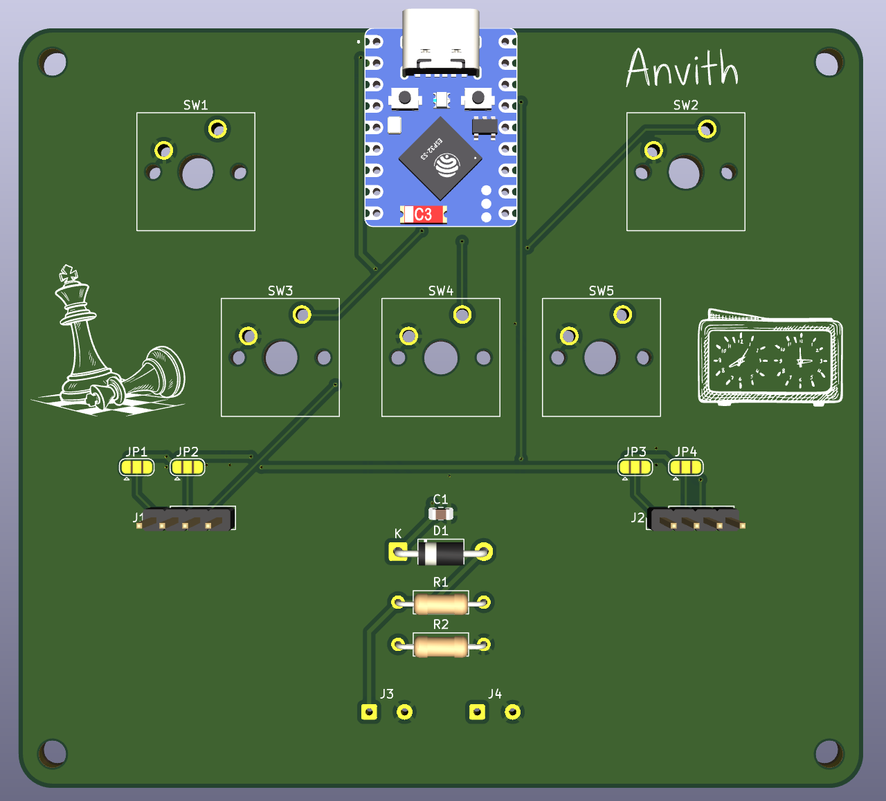
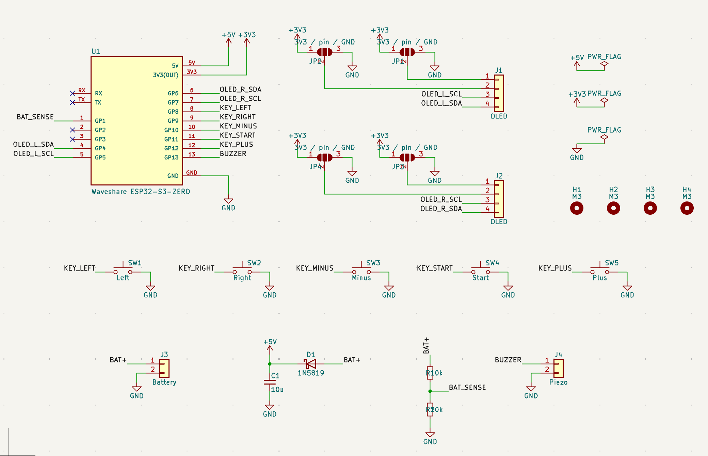
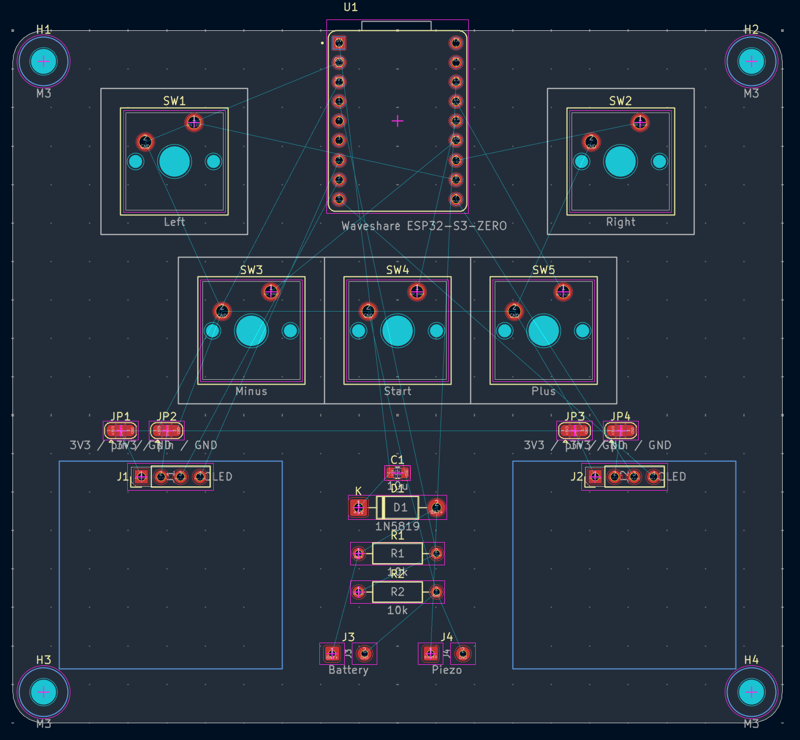
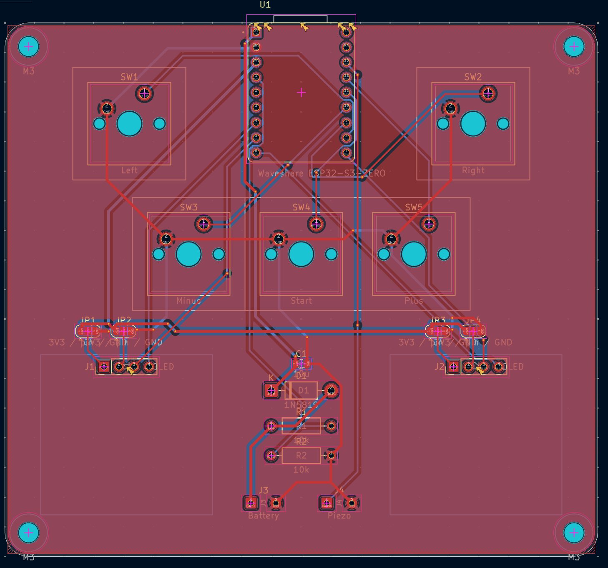
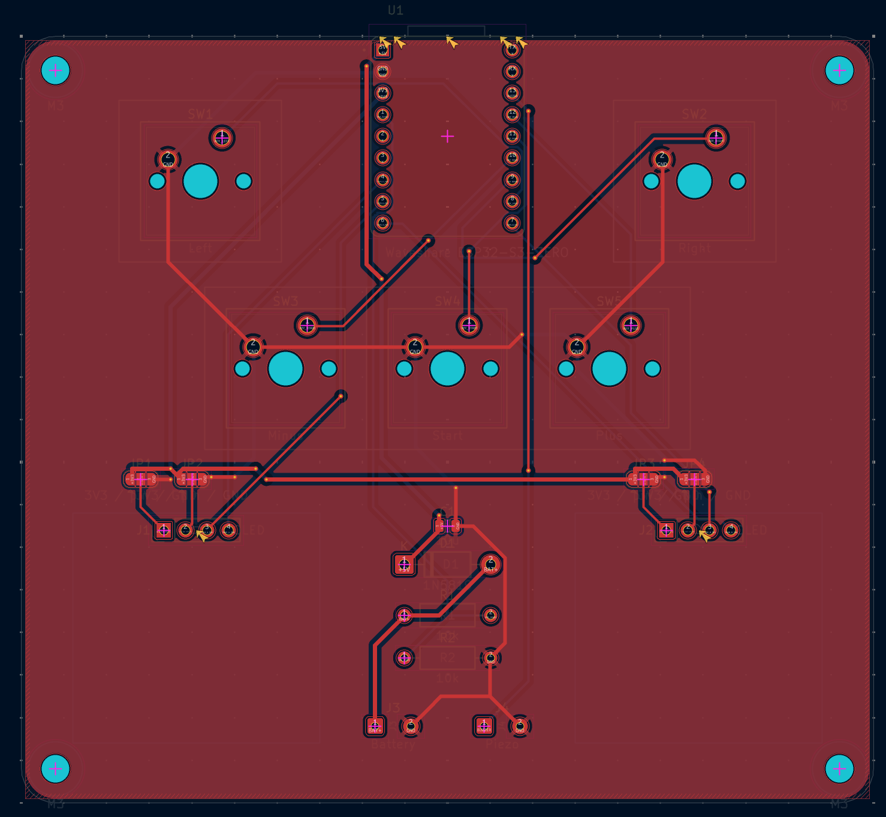
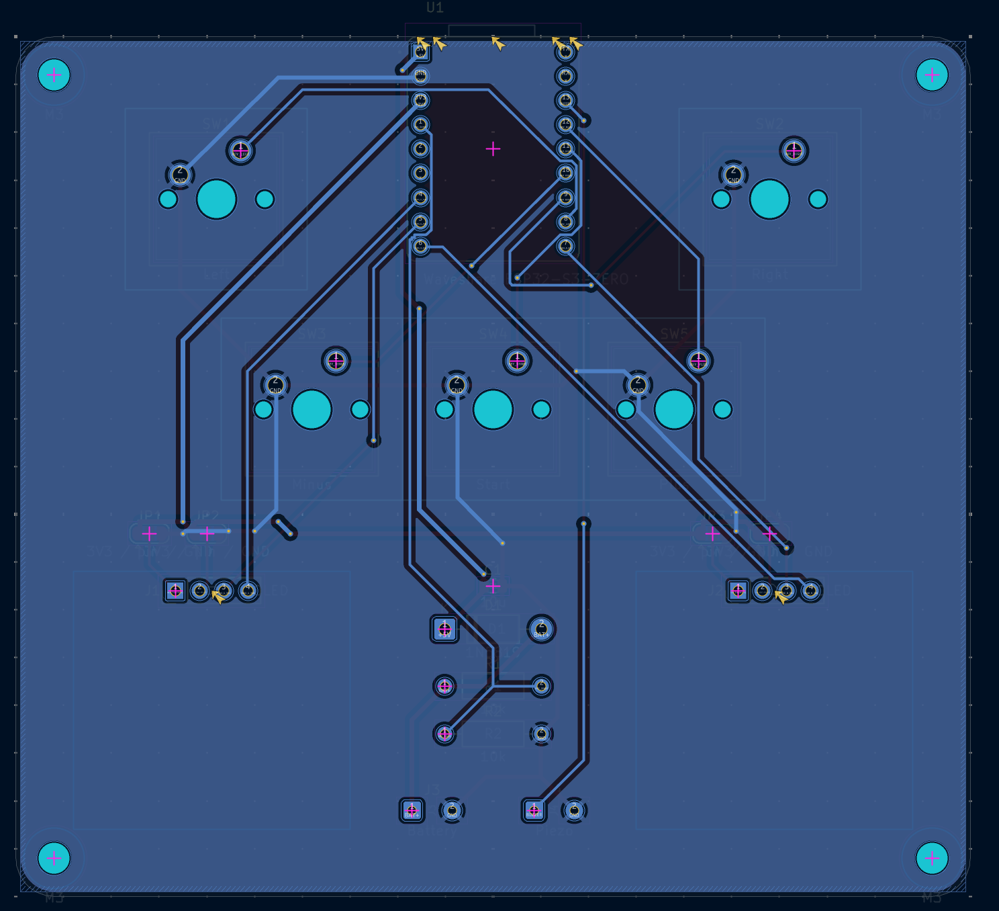
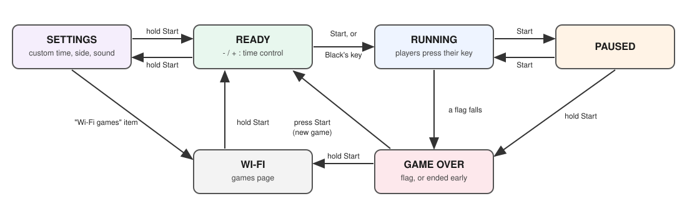
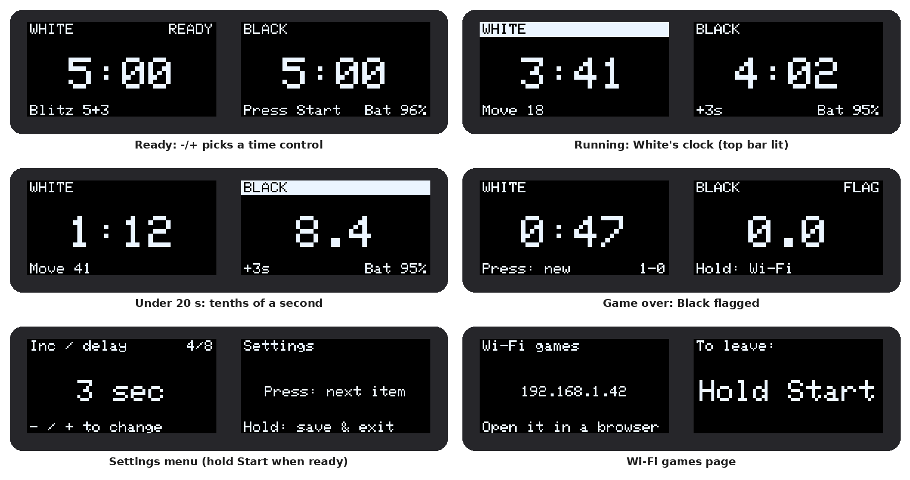
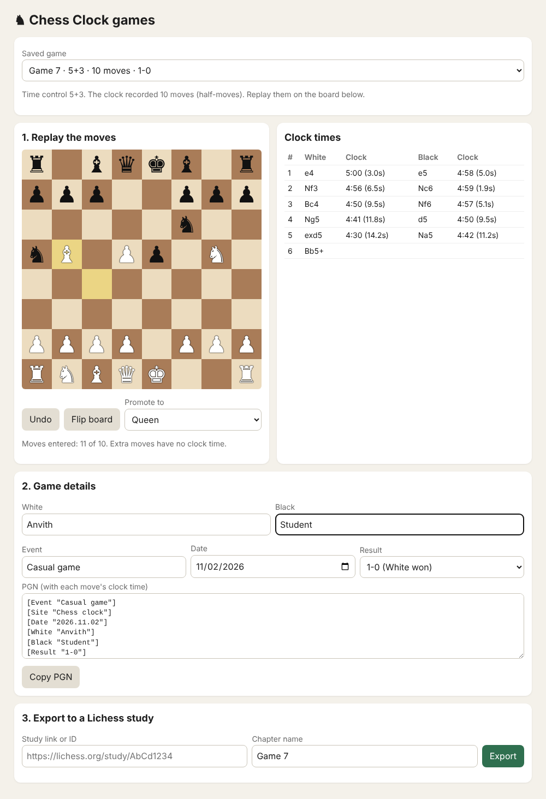
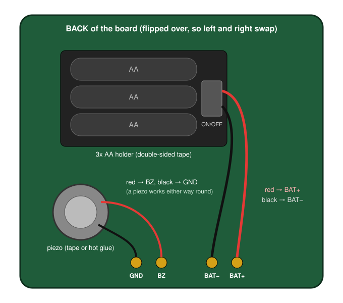

# HalfLifeWeek5-Custom

For Week 5 I designed a smart chess clock. It has two OLED screens side by side like a normal chess clock, 5 MX keys, a piezo buzzer, and it runs on 3 AA batteries. After a game, it can connect to Wi-Fi and export the game, with how much time each player had on every move, to a Lichess study.

**3D Model / Final PCB Render:**

**Schematic:**

**Board Layout & Routing:**

Combined Layout:

Front Copper Layer:

Back Copper Layer:

**What it is and how it works:**

Each player has a big key on their side. When you finish your move, you press your key, which stops your clock and starts your opponent's. The 3 keys in the middle are -, Start and +.

The clock has:

- 9 time control presets
- A custom mode where White and Black can have different times
- Increment or delay mode
- A double beep when you drop under 10 seconds, and a long beep when your time runs out
- Tenths of a second on the screen when you have under 20 seconds
- Saving of the last 5 games
- A page where you replay the moves and export the game to a Lichess study
- Deep sleep after 5 minutes of not being used

This is what the screens show during a game (the player whose turn it is gets a highlighted bar at the top):

These are the parts:

* **Waveshare ESP32-S3-Zero:** This is the brain of the board and runs the clocks, saves the games, and connects to Wi-Fi for the export.
* **2 OLED screens:** There is one for each player and shows all of the informaion.
* **4 solder jumpers:** Some of these screens have their pins in the order VCC, GND, SCL, SDA and others have GND, VDD, SCK, SDA. The jumpers let you pick the right order for your screens, so both versions work on the same PCB.
* **5 MX keys:** Each key connects a pin to GND, and the ESP32's pull-up resistors keep the pin HIGH until it's pressed.
* **1N5819 diode:** The 3 AA batteries go through this into the 5V pin. When USB is plugged in, it stops USB power from flowing back into the batteries.
* **2 10k resistors:** These halve the battery voltage so the ESP32 can read the battery level.
* **10uF capacitor:** This smooths out the 5V power.
* **Piezo buzzer:** This makes the beeps.

To export a game, hold Start after the game ends. The clock connects to Wi-Fi and shows its IP address on the left screen. Open that address in a browser on the same Wi-Fi. The page builds the PGN with the clock time for every move, and the clock sends it to the Lichess study.

Note: I used Claude to help write the webpage/exporting part of the code.

**Why I made it:**

I play and coach chess a lot, so a chess clock is something I would actually use. Normal chess clocks don't save anything, so after an over-the-board game, there's no record of how much time each move took. To put it into a chess engine to analyze the game, we would have to notate the game, and then after the game manually enter the moves. With this clock, I can put the game into Lichess and see where I spent too much time. This was also my first project without a guide, where I made the schematic, PCB and firmware all on my own.

**How to assemble and flash the firmware:**

**1. How to assemble the board**

You need a soldering iron, solder, flux, tweezers, flush cutters, a multimeter, and double-sided tape.

First, set the screen jumpers. Look at the back of your screens and check the pin labels. If the screen says VCC GND SCL SDA, bridge the middle pad of JP1 and JP3 to the 3V3 pad, and bridge the middle pad of JP2 and JP4 to the GND pad. If it says GND VDD SCK SDA, do the opposite.

To bridge a jumper, melt a little solder on the middle pad and drag it onto the pad you want.

Then solder from the flattest part to the tallest part:

1. **C1 (10uF capacitor):** Put a little solder on one pad, hold the capacitor with tweezers, and melt that pad to tack it down. Then solder the other end.
2. **R1, R2 (Resistors):** Bend the legs, push them through, solder and trim.
3. **D1 (Diode):** The grey stripe goes on the side with the bar on the silkscreen.
4. **U1 (ESP32-S3-Zero):** Line it up with the outline, with the USB-C port at the top edge. Tack one corner, then solder every edge pad and check for bridges.
5. **SW1–SW5 (MX keys):** Push each key in and then solder its 2 pins.
6. **J1, J2 (screens):** Push each screen's header pins through its 4 holes. Solder one pin, check that the screen is straight, then solder the rest.
7. **Keycaps:** Press them on.

The battery holder and piezo are the only parts with wires. They go on the back of the board:

1. Stick the battery holder to the back with double-sided tape. On J3 (labelled Battery), solder the red wire to the square pad (BAT+) and the black wire to the round pad (GND).
2. Stick the piezo disc to the back with tape or hot glue. Solder its wires to the 2 pads of J4 (labelled Piezo).

Before plugging in, use the multimeter in continuity mode to check that 5V, 3V3 and GND are not shorted, and that each jumper's middle pad only connects to one side.

**2. How to flash the firmware**

1. Install the Arduino IDE.
2. In the Boards Manager, install esp32 by Espressif Systems and select ESP32S3 Dev Module as the board.
3. Under the Tools menu, set USB CDC On Boot to Enabled so the Serial Monitor works over USB-C.
4. Install these libraries in the Library Manager:
   * Adafruit SSD1306
   * Adafruit GFX
   * ArduinoJson
5. Copy ChessClockArduino/secrets_example.h to ChessClockArduino/secrets.h and fill in your Wi-Fi name and password.
6. To export to Lichess, make a token with the study:write scope [here](https://lichess.org/account/oauth/token/create?scopes[]=study:write&description=Chess+Clock) and paste it into LICHESS_TOKEN in secrets.h. Then make a study on Lichess, and put its 8-character ID (from the study's URL) in DEFAULT_STUDY_ID at the top of ChessClockArduino.ino.
7. Open ChessClockArduino/ChessClockArduino.ino, plug the board in with a USB-C data cable, and click Upload. If it doesn't upload, hold the BOOT button on the ESP32-S3-Zero, tap RESET, release BOOT, and try again.

Both screens should show the time. Press Start, and White's clock should start counting down. secrets.h is in .gitignore, so your Wi-Fi password and token won't be uploaded to GitHub.

**BOM:**

The full bill of materials is in [BOM.csv](BOM.csv):

| Item | Qty | Supplier | Cost/item | Total cost | Link |
| --- | ---: | --- | ---: | ---: | --- |
| ESP32-S3-Zero (no headers) | 1 | AliExpress | $4.32 | $4.32 | [AliExpress](https://www.aliexpress.us/item/3256807949476561.html) |
| 0.96" OLED 128x64 I2C (SSD1306, white 2-pack) | 1 | AliExpress | $4.40 | $4.40 | [AliExpress](https://www.aliexpress.us/item/3256805954920554.html) |
| 27mm piezo with wires (10-pack) | 1 | AliExpress | $4.70 | $4.70 | [AliExpress](https://www.aliexpress.us/item/3256806921009045.html) |
| 3x AA battery holder with switch | 1 | AliExpress | $1.44 | $1.44 | [AliExpress](https://www.aliexpress.us/item/2255800794307346.html) |
| 1N5819 Schottky diode (50-pack) | 1 | AliExpress | $1.32 | $1.32 | [AliExpress](https://www.aliexpress.us/item/3256801365779334.html) |
| MX switches and keycaps (spare from Week 1) | 5 | — | $0.00 | $0.00 | — |
| 10k resistors (spare from Week 1) | 2 | — | $0.00 | $0.00 | — |
| 10uF 0805 capacitor (spare from Week 4) | 1 | — | $0.00 | $0.00 | — |
| PCB | 1 | JLCPCB | $4.00 | $4.00 | [JLCPCB](https://jlcpcb.com/) |
| Shipping (AliExpress Choice) | — | AliExpress | — | $0.00 | — |
| Shipping (JLCPCB Global Standard Direct Line) | — | JLCPCB | — | $8.78 | — |
| Estimated sales tax (8.125% on AliExpress parts) | — | — | — | $1.31 | — |
| **Estimated total** |  |  |  | **$30.27** |  |
